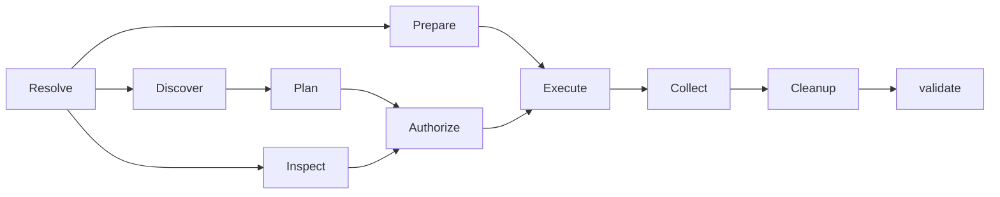

# CI Engine

A reusable, language-independent CI coordinator. Repositories own their operations, component manifests, toolchains, and publishing adapters. The engine owns GitHub workflow admission, operation resolution, dependency planning, execution boundaries, and the final result.

## Entry points

- **.github/workflows/bootstrap.yml** – a reusable workflow_call entry point, not a second manually runnable workflow
- **action.yml** – an independently usable composite action supporting resolve, prepare, discover, inspect, plan, authorize, execute and generated phases
- **src/** – the generic Lute runtime, without requiring a Node controller or any particular project language

The consumer's only permanent CI workflow calls Kooraseru-Hub/CI-Engine/.github/workflows/bootstrap.yml at an exact full commit SHA.

The consumer declares triggers and operations in .github/config/ci/engine.json. Read-only operations discover tracked component manifests, validate contracts, resolve capability dependencies, reject cycles and output collisions, then execute command arrays. Dependency providers execute before their consumers.

Generated operations invoke a **repository-owned execution adapter** only after the engine's separate trusted job passes its event, default-branch and protected-environment checks. Such an adapter can compile GitHub-native workflow DAGs, dispatch them, verify completion, publish, manage generated branches, and clean up. The engine does not hardcode toolchains, publishers, phases, or repository names. A nonzero adapter exit fails the required final result.

The reusable workflow has a **single entry point** and a fork-and-join DAG. Prepare, Discover, and Inspect run in parallel after Resolve. Plan depends on Discover; Authorize joins Plan and Inspect; Execute joins Prepare and Authorize. The remainder converges through Collect, Cleanup and validate.

All jobs have short labels and run on successful operations: read-only versus generated execution is a choice *inside* Execute, not two mutually skipped jobs. Inspect validates the execution boundary independently of component discovery. Prepare verifies the checked-out workspace; it **does not** install tools into Execute's separate runner. Consumer dependency installation remains component-owned until an explicit cache/artifact transport is needed. The engine does not automatically transfer filesystem state between jobs.

GitHub cannot insert new native jobs into an active workflow run. A project-owned generated pipeline must use a separate dispatched workflow or supported external backend.

## Credentials and trust

Untrusted pull requests cannot request a generated operation, and never enter the privileged job. Read-only jobs have contents: read and no publisher credentials. The trusted job alone has id-token: write, an explicit protected GitHub environment, and optional app_private_key / bootstrap_token secret inputs alongside vars.CI_APP_ID.

Manual publication additionally requires explicit confirmation. Real package or extension registry OIDC trust must be registered at the external publisher; the engine cannot bypass GitHub's environment protections or manufacture that trust.

Cross-owner workflows should use explicitly mapped secret inputs rather than assume secrets: inherit works everywhere. Template's permanent launcher maps conventional CI_APP_PRIVATE_KEY and CI_TOKEN repository secrets. Consumer credentials must be configured in GitHub, not committed.

Pin external reusable workflow references to full commit SHAs. The engine owns its action dependencies in its own .github/workflows/actions.lock; a consumer action lock does not pin external reusable workflow calls.

## Verification

The engine's own fixtures exercise the reusable-workflow path, component contracts, dependency planning, and positive/negative operation routing, independently of Template. Its first-pass read-only implementation was extended with a generic trusted generated-operation adapter; project-specific publishers remain outside the engine.

This branch is an integration candidate, not a tagged v1 release. Passing engine and consumer CI verifies workflow admission and unprivileged execution but does not prove live publication to external registries.

## Local act compatibility

GitHub supports action self-references such as `uses: $/`, but some current versions of `act` do not. A consumer's local-only launcher may stage a temporary copy of the exact pinned reusable workflow and translate those self-references to `Kooraseru-Hub/CI-Engine@<sha>`. This must happen only inside a disposable checkout; do not edit the hosted engine workflow or replace `$/` with a moving branch ref.

## Credential boundary for a universal graph

GitHub permissions are job-scoped. The single `Execute Pipeline` job has `id-token: write` so it can run a trusted generated adapter when authorized; read-only components do **not** receive the OIDC token vending variables or bootstrap credentials in their subprocess environments. The job uses the separate `ci-readonly` environment for unprivileged execution and the selected protected environment for generated operations. External OIDC trusted-publisher registrations must trust only the protected publishing environment, never `ci-readonly`.

If strict job-level least privilege is required, the alternative is to split the read-only and privileged lanes into distinct GitHub jobs. That would reintroduce the skipped execution branch in the graph; it is a deliberate design tradeoff and must be revisited when changing trust policies.

## Native source-push validation

A repository can declare an optional `native.command` in a read-only operation (for example, `validation`). On a **push to its configured default branch only**, the reusable workflow runs the ordinary read-only components, then invokes the declared command to create and monitor a build-only native execution tree. Ordinary feature-branch pushes, PRs, and manual read-only runs do not receive this launch credential. No new permanent workflow or job branch is added.

The native launch step receives an explicit short-lived repository-scoped GitHub App token or a separately configured `bootstrap_token`; the default `GITHUB_TOKEN` cannot trigger push workflows when it creates a branch. The source-push Execute stage runs under the configured `ci-bootstrap` environment, while all untrusted read-only runs remain under `ci-readonly`. Repository maintainers must scope environment protection and the GitHub App's Contents/Workflows permissions correctly.

The native adapter is supplied by the consuming repository and must fail when its generated run fails. The engine does not automatically publish packages, pages, releases or branches; those are separate, explicitly authorized operations.
